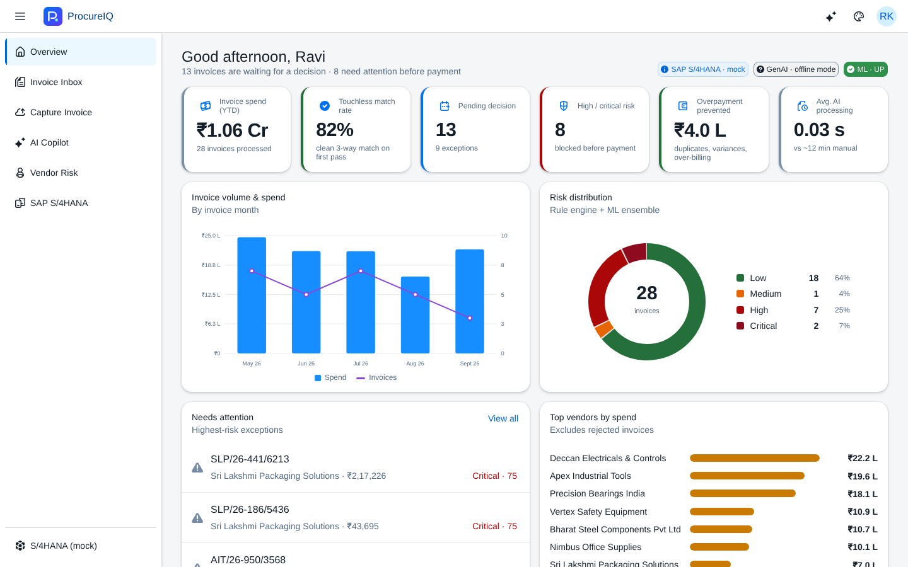
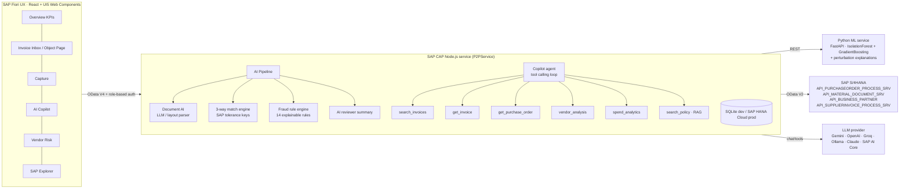
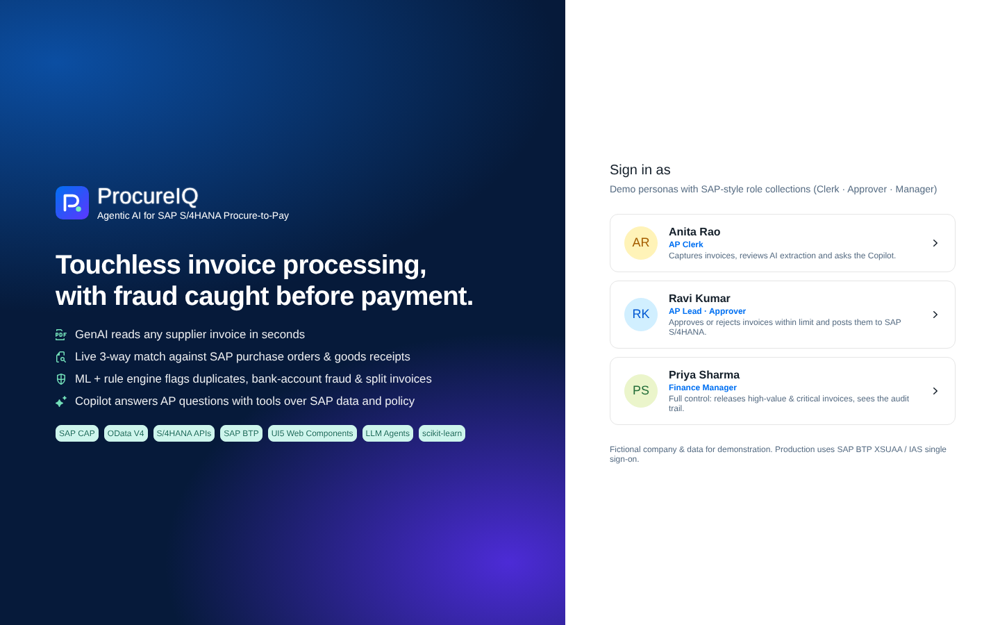
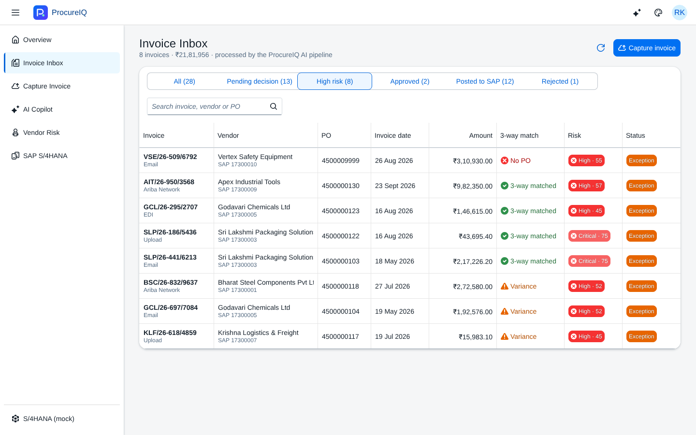
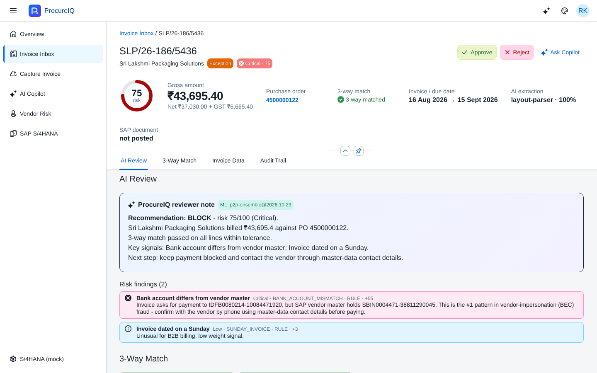
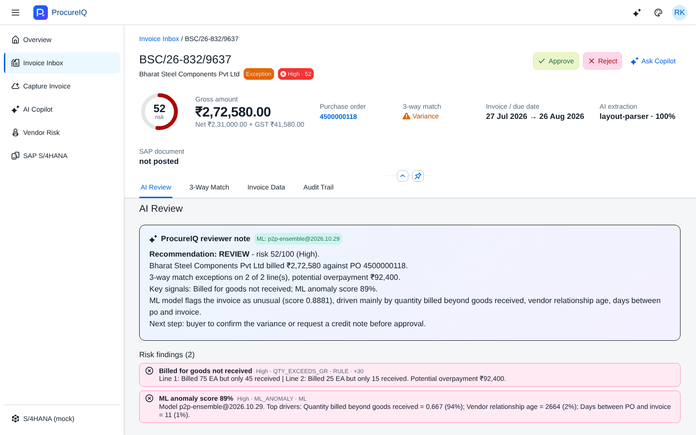
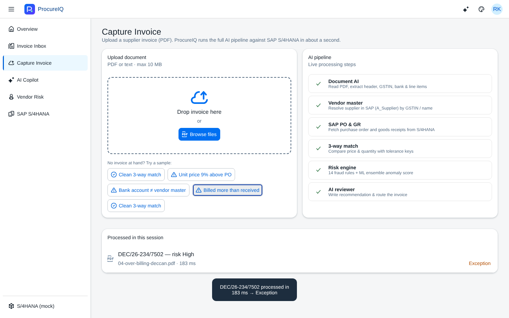
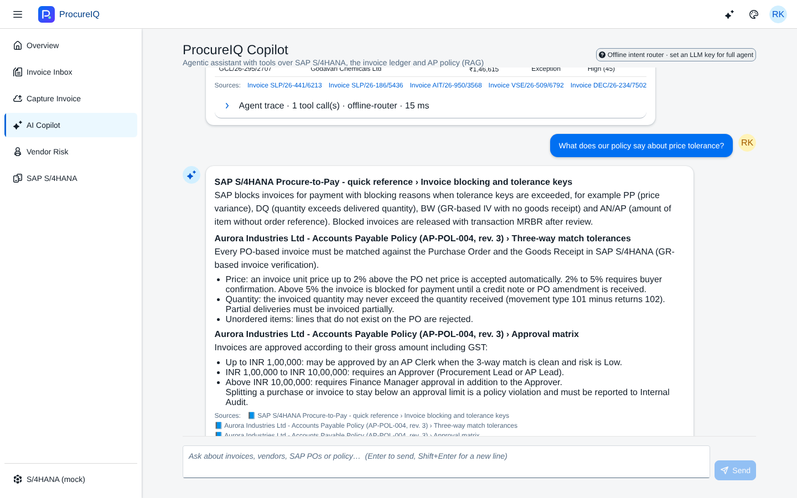
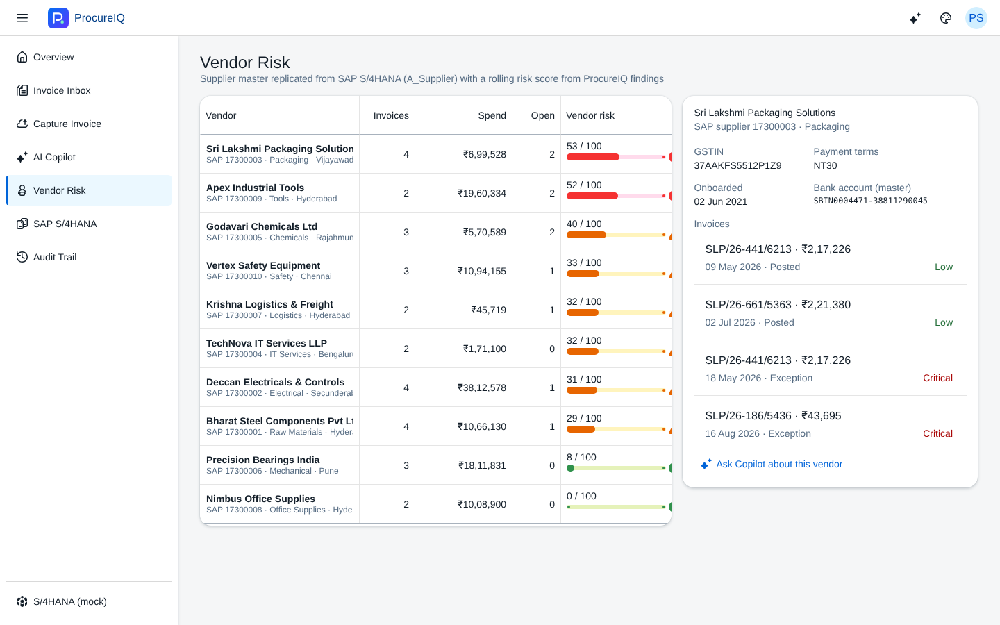
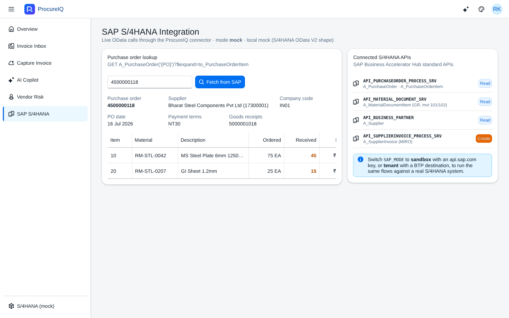

# ProcureIQ — Agentic AI Procure-to-Pay Copilot for SAP S/4HANA

> GenAI document understanding + SAP 3-way match + ML fraud detection + a tool-calling AI agent, built on **SAP CAP** and **SAP Fiori (UI5 Web Components)**, deployable to **SAP BTP**.



**The business problem.** Large companies running SAP receive thousands of supplier invoices a month. Accounts-payable clerks key them in by hand and check each one against the Purchase Order and the Goods Receipt (the *3-way match*). Industry benchmarks put manual processing at roughly 10–15 minutes per invoice, and duplicate payments, price creep and vendor-impersonation fraud cost real money every year.

**What ProcureIQ does.** It reads any supplier invoice PDF, checks it live against SAP S/4HANA, scores fraud risk with a rule engine plus an ML ensemble, and writes a reviewer note for the approver. Clean invoices go straight to approval. Risky ones are blocked, with a clear explanation. An AI Copilot answers questions like *"why is this invoice blocked?"* by calling tools over SAP data, the invoice ledger and company policy (RAG).

| Metric (demo dataset) | Result |
|---|---|
| End-to-end processing per invoice | **~50 ms** (deterministic parser) · a few seconds with an LLM |
| Touchless 3-way match rate | **~82 %** |
| Fraud scenarios caught | duplicates · bank-account change · split invoicing · over-billing · price creep · GSTIN mismatch · non-PO spend |
| ML model (held-out, harder-than-training fraud) | ROC-AUC **0.99** · precision **1.00** · recall **0.80** |
| Automated tests | **29** Node (unit + API) + **4** Python |

---

## Architecture



### The pipeline (`srv/pipeline.js`)

1. **Intake de-duplication.** A SHA-256 hash of the document stops the same file from entering the workflow twice.
2. **Document AI.** PDF text extraction, then LLM JSON extraction. Without an LLM it uses a deterministic layout parser tuned for Indian GST invoices. Arithmetic cross-checks (lines = subtotal, subtotal + tax = total, qty × rate = amount, GSTIN format) produce a confidence score.
3. **Vendor resolution.** Matches the invoice to the SAP supplier master by GSTIN first, then by fuzzy name.
4. **SAP lookup.** Fetches the purchase order and goods receipts (movement types 101/102) live from S/4HANA.
5. **3-way match.** Line matching by PO item, then material, then description similarity. Price tolerance is 2 % warn / 5 % block, quantity must be ≤ goods received, and lines must exist on the PO. This mirrors SAP MIRO tolerance keys PP, DQ and BW.
6. **Risk scoring.** 14 explainable rules plus an ML anomaly score, with severity floors so a single critical signal can't be averaged away.
7. **AI reviewer note.** An APPROVE / REVIEW / BLOCK recommendation with the concrete numbers.
8. **Workflow.** Approve or reject with segregation of duties, then **post to SAP** (`A_SupplierInvoice`). Every step is written to an immutable audit trail.

---

## Screenshots

| | |
|---|---|
|  |  |
| **Role-based sign-in** (Clerk / Approver / Manager) | **Invoice inbox** with match status and risk |
|  |  |
| **Bank-account fraud blocked** with AI explanation | **Over-billing caught**: billed 75, received 45 |
|  |  |
| **Live AI pipeline** on upload | **Copilot** with tool calls, sources and policy RAG |
|  |  |
| **Vendor risk** scoring | **Live S/4HANA purchase-order lookup** |

---

## Tech stack

| Layer | Technology |
|---|---|
| Backend | **SAP Cloud Application Programming Model (CAP)** Node.js, CDS domain model, OData V4, `@requires` role checks |
| SAP integration | S/4HANA Cloud standard OData APIs. Three modes: `mock` (bundled S/4-shaped data), `sandbox` (SAP Business Accelerator Hub), `tenant` (a real system with CSRF-token POST) |
| GenAI | Provider-agnostic LLM client with tool calling (OpenAI dialect + Anthropic). Structured JSON extraction. ReAct-style agent loop (max 6 steps). BM25 RAG over policy documents |
| ML | Python · FastAPI · scikit-learn. **Hybrid ensemble**: IsolationForest (unsupervised, catches novel patterns) + HistGradientBoosting (supervised on audit labels), plus perturbation-based feature attribution for explainability |
| Frontend | React 19 · **SAP UI5 Web Components for React** (Fiori Horizon theme, light/dark) · ObjectPage, AnalyticalTable · custom SVG charts |
| DevOps | Docker, docker-compose, GitHub Actions CI, **MTA descriptor for SAP BTP Cloud Foundry** (HANA HDI, XSUAA, Destination) |
| Quality | `node:test` unit + CAP integration tests, pytest, model card with metrics |

---

## Run it

### Option A: Docker (one command)

```bash
cp .env.example .env          # optional: add an LLM key
docker compose up --build
# open http://localhost:4004
```

### Option B: Local dev

```bash
# 1. ML service
cd ml-service && pip install -r requirements.txt && python train.py && uvicorn app:app --port 8000
# 2. Backend + built UI (new terminal, project root)
npm install && npm --prefix ui install && npm run build:ui
npm start                     # http://localhost:4004  -> sign in as any persona
# optional hot-reload UI: npm run dev:ui  (http://localhost:5173/ui/)
```

On first start, 28 demo invoices are replayed **through the real pipeline**, so the dashboard has realistic data. Sample PDFs for live upload are in `samples/invoices/`, or click **Try a sample** on the Capture page.

### Turn on GenAI (free options)

```bash
LLM_PROVIDER=gemini GEMINI_API_KEY=...   npm start     # Google AI Studio free tier
LLM_PROVIDER=groq   GROQ_API_KEY=...     npm start     # Groq free tier
LLM_PROVIDER=ollama                      npm start     # fully local (ollama pull llama3.1)
```

Without a key, the app runs in **offline mode**: a deterministic layout parser, an intent-router copilot over the same tools, and template reviewer notes. Everything still works.

### Connect to real SAP

```bash
# SAP Business Accelerator Hub sandbox (free): log in at api.sap.com and copy your API key
SAP_MODE=sandbox SAP_API_KEY=xxxx npm start
# A real S/4HANA system
SAP_MODE=tenant SAP_BASE_URL=https://my-s4.example.com SAP_USER=... SAP_PASSWORD=... npm start
```

### Deploy to SAP BTP

```bash
mbt build && cf deploy mta_archives/procureiq_1.0.0.mtar
```

Then assign the role collections `ProcureIQ_Clerk`, `ProcureIQ_Approver` and `ProcureIQ_Manager` in the BTP cockpit.

### Tests

```bash
npm test                      # 29 tests: match engine, fraud rules, extraction, RAG, full OData API
cd ml-service && pytest -q    # model quality gate (ROC-AUC >= 0.85), scoring and explanations
```

---

## Project structure

```
db/schema.cds              Domain model: Invoices, Items, MatchResults, Anomalies, Vendors, AuditLog
srv/p2p-service.cds|.js    OData V4 service, workflow actions, KPIs, authorization
srv/pipeline.js            End-to-end AI pipeline orchestration
srv/ai/                    llm.js (multi-provider) · extractor.js · copilot.js (agent) · knowledge.js (RAG)
srv/engine/                three-way-match.js · risk-rules.js · ml-client.js
srv/sap/                   s4-client.js (mock / sandbox / tenant) + S/4-shaped mock data
srv/knowledge/             AP policy, SAP P2P guide, fraud playbook (RAG corpus)
ml-service/                FastAPI + scikit-learn ensemble, training, model card, tests
ui/                        React + UI5 Web Components Fiori app
scripts/                   Deterministic demo-data and invoice-PDF generator
test/                      Unit + integration tests
mta.yaml, xs-security.json SAP BTP deployment
```

## Security and controls

- **Roles:** Clerk / Approver / Manager. Clerks cannot approve. Invoices above ₹10 lakh and Critical-risk invoices need a Finance Manager. Approving an exception requires a written justification.
- **Audit:** every pipeline step and decision is logged with actor and timestamp.
- **Duplicate prevention:** both at document level (hash) and at business level (vendor + invoice number, same amount within 30 days).
- **Defence in depth:** ML-service or LLM outages degrade gracefully to deterministic fallbacks, so invoice processing never stops.

## Roadmap

- Multimodal extraction for scanned and photographed invoices (vision LLM / SAP Document Information Extraction)
- SAP Event Mesh trigger on new S/4 supplier invoices, and SAP Build Process Automation approval workflow
- SAP HANA Cloud Vector Engine for RAG at scale
- Retrain the ML model on real RBKP/RSEG history plus audit outcomes

---

*All companies, vendors and data in this repository are fictional and generated for demonstration.*

Built by **Kunduru Manikanta Reddy** · B.Tech CSE (AI & ML) · [LinkedIn](https://linkedin.com/in/manikanta-reddy-9a030932a) · [GitHub](https://github.com/manikantar585-lgtm)
